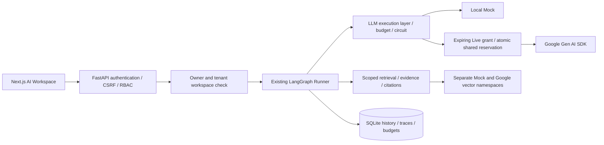

# AgentOps AI

A local AI engineering workbench for permission-scoped agents, multi-agent workflows and document-grounded answers. Built with FastAPI, Next.js, LangGraph and SQLite, with explicit Mock execution and guarded Google Gemini integration.

**v1.2:** controlled Gemini/Google embeddings dispatch is implemented. Live is disabled by default and requires a separately approved, expiring data-and-budget grant. This release made **zero external AI calls**. SDK contract tests use local HTTP fixtures; they are not evidence of Google model quality or project quota. This project is not production-ready.

## What it does

- Single-agent and Planner → Researcher → Executor → Reviewer workflows through LangGraph, with state, bounded revisions, cancellation and durable step history.
- Real local calculator, date/time, JSON validation, allowlisted HTTP fetch and knowledge search; bundled read-only MCP server. Write actions require human approval and idempotency checks.
- PDF extraction, page-aware chunking, lexical/semantic/hybrid retrieval and RRF. Sources, exact quotations, evidence sufficiency, bounded targeted retrieval, claim/citation verification and answer repair remain part of the RAG pipeline.
- Email/password authentication, opaque HttpOnly sessions, CSRF checks, admin/operator/viewer RBAC and tenant/owner workspace isolation.
- AI Workspace for uploads, indexing state, questions, citations, source viewing, history and cancellation. RU/EN, light/dark and responsive layout.
- Model registry, shared request/token/USD reservations, bounded retry, circuit breaker, explicit fallback policy and metadata-only LLM traces.
- Versioned evaluation datasets and Mock benchmarks; synthetic smoke runner with Dry Run, export, stop conditions and per-case references kept outside model context.

## Architecture



Backend: Python 3.13, FastAPI, SQLAlchemy, Alembic, LangGraph, Pydantic and google-genai. Frontend: TypeScript, React, Next.js. Local storage: SQLite, isolated PDF files, vector/cache tables and LangGraph checkpoints. Tests: pytest, Vitest and Playwright.

## Local setup

Use Python 3.13 and Node.js 24 for the checked dependency set. On Windows:

```powershell
./scripts/setup.ps1
```

For a new checkout only, copy `backend/.env.example` to `backend/.env` if no local configuration exists. Do not overwrite an existing `.env`. The example defaults to Mock and contains no key. A Gemini key is unnecessary for local automated tests.

Create the first local browser administrator interactively after migrations:

```powershell
cd backend
./.venv/Scripts/python.exe ../scripts/create-local-admin.py --email developer@example.test
```

The password is entered without echo; existing accounts are never reset. The bootstrap rejects nonlocal databases. Run the backend and frontend in separate terminals from the repository root:

```powershell
./scripts/start-backend.ps1
./scripts/start-frontend.ps1
```

Open http://127.0.0.1:3000/login and then `/ai`. Upload a permitted PDF, wait for indexing and ask in `MOCK_ONLY`. A deterministic Mock result is labeled Mock and does not measure real LLM quality. Never use local development credentials on shared services. `DEV_CREDENTIALS.example.md` is a structure-only template; local credentials, secrets and databases are ignored.

## Live readiness

The selected documentation snapshot uses `gemini-3.5-flash-lite` and text-only `gemini-embedding-2` at 768 dimensions. Google project availability, Free Tier eligibility and quota remain UNVERIFIED. Dry Run persists a scoped call plan without network dispatch. `REAL_EXECUTION` additionally requires the default-false server gate, a current administrator grant bound to exact documents and dataset, and budgets checked before every generation/embedding operation. There is no automatic billing setup or expensive fallback.

See [v1.2 architecture and measured verification](docs/v1.2.md) and [future Live approval template](docs/v1.2-live-approval.md). The template is not permission to call Google. Shared conservative reservations retain ambiguous costs; actual provider invoice cost is never inferred from a token estimate.

## Testing

```powershell
cd backend
./.venv/Scripts/python.exe -m pytest -q --basetemp=.pytest-work/local-check
cd ..
npm test
npm run typecheck
$env:NEXT_DIST_DIR='.next-v12'
npm run build
npm run test:e2e
```

Playwright starts isolated Mock servers and requires a locally installed Chromium (`npx playwright install chromium` during setup). Use a fresh pytest basetemp directory on Windows. Keep a separate Next build directory from any running dev server. No real AI request is performed by the automated suites. Final v1.2 counts and benchmark reruns are recorded in the version report rather than inferred from historical results.

## Security and current limits

Local-only proxy origins, session/RBAC checks, document permissions, exact source validation, tool/network allowlists, SSRF protection, approval idempotency and secret redaction are tested. Uploaded runtime documents, databases, session material, credentials, logs, backups, virtual environments and builds must never be committed. Test corpus material is synthetic; do not substitute private company documents into versioned fixtures.

SQLite and in-process jobs target a local single-process application, not a distributed multiworker service. There is no MFA, managed identity lifecycle, hardened public hosting or provider invoice reconciliation. A documentation snapshot is not live model validation. Review data-use terms and current provider limits before separately authorizing any external transmission.
