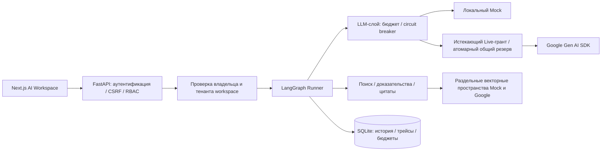
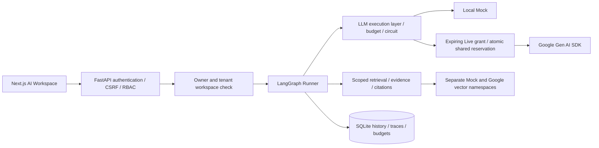

# AgentOps AI

**[Русский](#русский)** · **[English](#english)**

---

# Русский

**Локальный инженерный workbench для AI-агентов с разграничением прав, мультиагентных workflow и ответов по
документам с цитатами.** Сделан на FastAPI, Next.js, LangGraph и SQLite; по умолчанию работает в режиме Mock, а
интеграция с Google Gemini включается только под контролем.

**Версия v1.2:** реализована контролируемая отправка запросов в Gemini и эмбеддингов Google. Live-режим по умолчанию
выключен и требует отдельно одобренного гранта с ограниченным сроком, данными и бюджетом. Этот релиз сделал **ноль
внешних AI-вызовов**. Контрактные тесты SDK используют локальные HTTP-фикстуры и не доказывают качество моделей Google
или квоту проекта. **Проект не готов к production.**

## 1. Что это и зачем

AgentOps AI — это рабочее место, где можно:

- создавать агентов и задачи и запускать их;
- строить мультиагентные цепочки Planner → Researcher → Executor → Reviewer;
- давать агентам инструменты (калькулятор, дата/время, проверка JSON, HTTP по белому списку, поиск по базе знаний,
  MCP) с одобрением человеком для записи;
- загружать PDF и задавать вопросы по ним с точными цитатами и проверкой утверждений;
- контролировать стоимость вызовов моделей (резервы токенов и долларов), надёжность (retry, circuit breaker) и
  качество (наборы для оценки, бенчмарки).

Всё работает локально; внешние вызовы возможны только после явного разрешения.

## 2. Возможности

- **Агенты и задачи:** CRUD агентов и задач, запуск, история выполнений и событий, отмена.
- **Мультиагентные workflow (LangGraph):** Planner → Researcher → Executor → Reviewer, состояние, ограниченное число
  ревизий, отмена, сохранение истории шагов, чекпоинты LangGraph в SQLite.
- **Инструменты:** калькулятор, дата/время, валидация JSON, HTTP fetch по allowlist (с защитой от SSRF), поиск по
  знаниям; встроенный read-only MCP-сервер. Действия записи требуют одобрения человека и проверки идемпотентности.
- **RAG по документам:** извлечение текста PDF, чанки с учётом страниц, лексический/семантический/гибридный поиск и
  RRF, источники и точные цитаты, проверка достаточности доказательств, целевой дополнительный поиск, проверка
  утверждений и цитат, исправление ответа.
- **Аутентификация и доступ:** email/пароль, непрозрачные HttpOnly-сессии, CSRF, роли `admin` / `operator` /
  `viewer`, изоляция workspace по владельцу и тенанту, аудит входов, сброс пароля.
- **AI Workspace:** загрузки, состояние индексации, вопросы, цитаты, просмотр источников, история, отмена. RU/EN,
  светлая/тёмная тема, адаптивная вёрстка.
- **LLM-слой:** реестр моделей, общие резервы запросов/токенов/USD, ограниченный retry, circuit breaker, явная
  политика fallback, трейсы LLM только с метаданными, версии промптов, сравнения.
- **Оценка:** версионированные наборы данных, Mock-бенчмарки, синтетический smoke-прогон с Dry Run, экспортом,
  условиями остановки и эталонами вне контекста модели.
- **Live-готовность:** Dry Run сохраняет план вызовов без сети; `REAL_EXECUTION` требует серверного флага, текущего
  гранта администратора на конкретные документы и набор, и проверки бюджета перед каждой операцией.

## 3. Стек технологий

| Слой | Технологии |
| --- | --- |
| Backend | Python 3.13, FastAPI, Uvicorn, Pydantic + pydantic-settings, SQLAlchemy 2, Alembic |
| Агенты | LangGraph 1.x, langgraph-checkpoint-sqlite |
| LLM | google-genai (Gemini `gemini-3.5-flash-lite`, эмбеддинги `gemini-embedding-2`, 768 измерений), локальный Mock |
| Документы | pypdf (извлечение PDF), собственный векторный индекс и кэш эмбеддингов в SQLite |
| Прочее backend | jsonschema, httpx, psycopg 3 (опционально) |
| Frontend | Next.js 16, React 19, TypeScript 5.7, Tailwind CSS 4; npm workspaces |
| База данных | SQLite (`data/agentops.db`): история, трейсы, бюджеты, чекпоинты |
| Тесты | pytest (220 тестов), Vitest, Playwright (15 e2e-файлов) |
| CI | GitHub Actions |
| Инфраструктура | Docker Compose (опционально), PowerShell-скрипты для Windows |

## 4. Архитектура



Frontend обращается к backend через прокси-маршрут Next.js `src/app/api/[...path]/route.ts` (только локальные
origin).

## 5. Структура проекта

```text
backend/
  app/main.py                 FastAPI-приложение: агенты, задачи, выполнения, dashboard, провайдеры, модели, инструменты
  app/authentication.py, password_security.py   вход, сессии, пользователи, роли, аудит
  app/workflow_api.py, workflow_service.py, workflow_execution.py, workflow_schemas.py   мультиагентные workflow
  app/execution.py, services.py, repository.py, schemas.py   выполнение задач и доступ к данным
  app/tools.py, tool_api.py, tool_execution.py, http_tool.py   инструменты и одобрение
  app/local_mcp_server.py, mcp_client.py   встроенный MCP-сервер и клиент
  app/knowledge_api.py, knowledge_store.py, pdf_extract.py   база знаний и PDF
  app/embeddings.py, embedding_validation.py, vector_index.py, hybrid_search.py   эмбеддинги и поиск
  app/rag_answers.py, evidence.py, answer_verification.py   ответы с цитатами и их проверка
  app/llm_api.py, llm_reliability.py, providers.py   LLM-слой, бюджеты, промпты
  app/evaluation*.py, validation*.py, calibration.py   оценка и валидация
  app/ai_workspaces.py, workspace_live.py, workspace_smoke.py   AI Workspace и Live-режим
  app/live_authorization.py, live_embedding_budget.py, live_envelope.py, live_smoke*.py   гранты и бюджеты Live
  app/sensitive_context.py, unscoped_dispatch.py   защита чувствительных данных
  app/knowledge/          встроенные документы базы знаний
  migrations/             Alembic
  tests/                  pytest
frontend/
  src/app/                login, ai, users, profile, access-denied, session-expired, api/[...path] (прокси)
  src/components/         ai-workspace, workflow-graph, workflow-workspace, knowledge-workspace, tool-catalog,
                          evaluation-workspace, validation-workspace, observability-workspace, live-controls…
  src/lib/                API, i18n по разделам, типы
  e2e/                    Playwright
scripts/                  setup.ps1, start-backend.ps1, start-frontend.ps1, create-local-admin.py, check.ps1,
                          проверки и отчёты по версиям (v02…v12), verify-secrets.py
docs/                     отчёты по версиям v0.2…v1.2, архитектура, RAG, проверки
docker-compose.yml
```

## 6. Модель данных (SQLite)

| Группа | Таблицы |
| --- | --- |
| Агенты и задачи | `agents`, `tasks`, `executions`, `execution_events` |
| Workflow | `workflows`, `workflow_runs`, `workflow_steps`, `workflow_events` |
| Инструменты | `tool_calls`, `tool_notes` |
| Знания | `knowledge_documents`, `knowledge_chunks`, `knowledge_vectors`, `embedding_cache` |
| LLM | `llm_configurations`, `prompt_versions`, `llm_executions`, `budget_reservations` |
| Оценка | `evaluation_runs`, `evaluation_cases`, `evaluation_comparisons`, `validation_runs` |
| Аутентификация | `users`, `user_sessions`, `login_attempts`, `auth_audit`, `password_resets` |

## 7. API

| Группа | Эндпоинты |
| --- | --- |
| Здоровье | `GET /health` |
| Аутентификация | `GET /api/auth/csrf`, `POST /api/auth/login`, `GET /api/auth/me`, `POST /api/auth/logout`, `GET /api/auth/sessions`, `POST /api/auth/sessions/{id}/revoke`, `POST /api/auth/password`, `POST /api/auth/reset` |
| Пользователи (admin) | `GET/POST /api/users`, `PATCH /api/users/{id}`, `POST /api/users/{id}/revoke-sessions`, `POST /api/users/{id}/reset-password`, `GET /api/users/audit` |
| Агенты и задачи | `GET/POST /api/agents`, `GET/PUT/DELETE /api/agents/{id}`, `GET/POST /api/tasks`, `GET/PUT/DELETE /api/tasks/{id}`, `POST /api/tasks/{id}/run` |
| Выполнения | `GET /api/executions`, `GET /api/executions/{id}`, `GET /api/executions/{id}/events`, `POST /api/executions/{id}/cancel` |
| Workflow | `GET/POST /api/workflows`, `GET/PUT/DELETE /api/workflows/{id}`, `POST /api/workflows/{id}/run`, `GET /api/workflow-runs`, `GET /api/workflow-runs/{id}`, `.../steps`, `.../events`, `POST .../cancel` |
| Инструменты и MCP | `GET /api/tools`, `GET /api/mcp-servers`, `POST /api/mcp-servers/local-readonly/discover`, `GET /api/tool-calls`, `POST /api/tool-calls/{id}/decision` |
| Знания | `GET/POST /api/knowledge/documents`, `GET/DELETE /api/knowledge/documents/{id}`, `.../chunks`, `.../embedding-plan`, `POST .../reindex`, `GET /api/knowledge/runs`, `POST /api/knowledge/search`, `POST /api/knowledge/ask` |
| LLM | `GET /api/providers`, `GET /api/models`, `POST /api/models/discover`, `GET /api/llm/requests`, `GET /api/llm/requests/{id}`, `GET /api/llm/summary`, `GET /api/llm/configuration`, `PUT /api/llm/models`, `PUT /api/llm/policy`, `PUT /api/llm/budget`, `GET/POST /api/llm/prompts`, `PUT /api/llm/prompts/{id}/{version}/{status}`, `GET/POST /api/llm/comparisons` |
| Оценка | `GET /api/evaluation/dataset`, `POST /api/evaluation/install`, `GET/POST /api/evaluation/runs`, `GET /api/evaluation/runs/{id}`, `.../cases`, `POST .../cancel`, `GET /api/evaluation/live-preflight` |
| Валидация | `GET/POST /api/validation/datasets`, `POST /api/validation/prepare/{source}`, `POST /api/validation/readiness`, `POST /api/validation/approvals`, `GET/POST /api/validation/runs`, `GET /api/validation/runs/{id}`, `POST .../cancel`, `GET .../export/{format}`, `POST /api/validation/comparisons` |
| Live smoke | `GET /api/validation/smoke/status`, `POST .../prepare`, `POST .../readiness`, `GET/POST .../runs`, `GET .../runs/{id}`, `POST .../runs/{id}/reviews`, `POST .../runs/{id}/cancel`, `GET .../runs/{id}/export` |
| AI Workspaces | `GET/POST /api/workspaces`, `GET /api/workspaces/{id}/readiness`, `POST .../live`, `GET .../live-status`, `POST .../smoke/prepare`, `GET/POST .../smoke`, `GET .../smoke/{run}`, `POST .../smoke/{run}/cancel`, `POST .../authorizations`, `GET/DELETE .../authorizations/{grant}`, `POST .../dry-run`, `GET .../dry-runs`, `POST .../google/{grant}/reindex` |
| Dashboard | `GET /api/dashboard` |

## 8. Конфигурация (`backend/.env`)

| Переменная | По умолчанию | Назначение |
| --- | --- | --- |
| `DATABASE_URL` | `sqlite:///./data/agentops.db` | База данных |
| `LLM_PROVIDER` | `mock` | `mock` или Gemini |
| `GEMINI_API_KEY` | — | Ключ Google Gemini (не нужен для тестов) |
| `GEMINI_MODEL` | `gemini-3.5-flash-lite` | Модель ответов |
| `EXTERNAL_API_ENABLED` | `false` | Разрешить внешние вызовы |
| `REAL_VALIDATION_ENABLED` | `false` | Реальная валидация моделей |
| `WORKSPACE_LIVE_ENABLED` | `false` | Live-режим AI Workspace |
| `PAID_OPERATIONS_ENABLED` | `false` | Разрешить платные операции |
| `LOCAL_MCP_ENABLED` | `true` | Встроенный read-only MCP-сервер |
| `HTTP_FETCH_ALLOWED_URLS` | `["https://example.com/"]` | Белый список для HTTP-инструмента |
| `APPROVAL_TIMEOUT_SECONDS` | `60` | Ожидание одобрения человеком |
| `EMBEDDING_PROVIDER`, `EMBEDDING_MODEL`, `EMBEDDING_DIMENSION` | `mock`, `gemini-embedding-2`, 768 | Эмбеддинги |
| `EMBEDDING_BATCH_SIZE`, `EMBEDDING_TIMEOUT_SECONDS`, `EMBEDDING_MAX_REQUESTS` | 32, 30, 32 | Лимиты эмбеддингов |
| `EMBEDDING_EXTERNAL_ENABLED` | `false` | Внешние эмбеддинги |

## 9. Установка и запуск (Windows)

Нужны Python 3.13 и Node.js 24.

```powershell
./scripts/setup.ps1
```

Для новой копии — скопируйте `backend/.env.example` в `backend/.env`, если локальной конфигурации ещё нет (не
перезаписывайте существующий `.env`). Пример работает в Mock и не содержит ключей.

Создайте первого локального администратора после миграций:

```powershell
cd backend
./.venv/Scripts/python.exe ../scripts/create-local-admin.py --email developer@example.test
```

Пароль вводится без отображения; существующие аккаунты не сбрасываются; для нелокальной БД скрипт отказывается
работать. Запуск в двух терминалах из корня репозитория:

```powershell
./scripts/start-backend.ps1
./scripts/start-frontend.ps1
```

Откройте http://127.0.0.1:3000/login, затем `/ai`. Загрузите PDF, дождитесь индексации и задайте вопрос в режиме
`MOCK_ONLY`. Ответ Mock помечен как Mock и не измеряет качество реальной LLM.

## 10. Live-режим

Выбранный снимок документации: `gemini-3.5-flash-lite` и текстовый `gemini-embedding-2` (768 измерений).
Доступность проекта Google, Free Tier и квота НЕ ПРОВЕРЕНЫ. Dry Run сохраняет план вызовов без сети.
`REAL_EXECUTION` требует серверного флага (по умолчанию выключен), текущего гранта администратора на конкретные
документы и набор, и проверки бюджета перед каждой генерацией/эмбеддингом. Автоматической настройки оплаты и дорогого
fallback нет. Подробно: [docs/v1.2.md](docs/v1.2.md), [шаблон одобрения Live](docs/v1.2-live-approval.md) (шаблон —
не разрешение вызывать Google).

## 11. Проверки и тесты

```powershell
cd backend
./.venv/Scripts/python.exe -m pytest -q --basetemp=.pytest-work/local-check
cd ..
npm test
npm run typecheck
$env:NEXT_DIST_DIR='.next-v12'
npm run build
npm run test:e2e
```

220 backend-тестов (аутентификация, API, workflow, инструменты, RAG, эмбеддинги, оценка, доказательства, надёжность
LLM, Live, миграции, валидация), Vitest-тесты frontend и 15 Playwright-сценариев. Playwright запускает изолированные
Mock-серверы и требует локальный Chromium (`npx playwright install chromium`). На Windows используйте новый
`--basetemp`. Автотесты не делают реальных AI-запросов.

## 12. Безопасность и ограничения

Протестированы: только локальные origin прокси, проверки сессий и ролей, права на документы, точная проверка
источников, allowlist инструментов и сети, защита от SSRF, идемпотентность одобрений, скрытие секретов. Загруженные
документы, БД, сессии, учётные данные, логи, backup, виртуальные окружения и сборки не коммитятся. Тестовый корпус —
синтетический.

SQLite и задачи внутри процесса рассчитаны на локальное однопроцессное приложение. Нет MFA, управляемого жизненного
цикла учётных записей, защищённого публичного хостинга и сверки со счетами провайдера.

## 13. История версий

[v0.2](docs/v0.2.md) (Live-проверка) → [v0.3](docs/v0.3.md) (инструменты) → v0.4 (RAG) → [v0.5](docs/v0.5.md)
(эмбеддинги) → [v0.6](docs/v0.6.md) (оценка) → [v0.7](docs/v0.7.md) (доказательства) → [v0.8](docs/v0.8.md) →
[v0.9](docs/v0.9.md) / [v0.9.1](docs/v0.9.1.md) (производительность) → [v1.0](docs/v1.0-authentication.md)
(аутентификация) → [v1.1](docs/v1.1.md) (AI Workspace) → [v1.2](docs/v1.2.md) (контролируемый Gemini).
Архитектура: [docs/architecture.md](docs/architecture.md), RAG: [docs/rag.md](docs/rag.md).

## 14. Ветки и статус

| Ветка | Что в ней |
| --- | --- |
| `main` | Актуальный код v1.2 (2026-10-15) |

**Статус:** работает локально в режиме Mock. Реальные вызовы Gemini не выполнялись; качество моделей и квота не
проверены. Не готов к production.

## 15. Планы

- [ ] Одобрить Live-грант и прогнать реальную проверку Gemini ([docs/v1.2-live-approval.md](docs/v1.2-live-approval.md)).
- [ ] Измерить качество RAG на реальной модели.
- [ ] MFA и управление жизненным циклом учётных записей.
- [ ] Многопроцессный/распределённый режим (вместо SQLite и задач в процессе).
- [ ] Защищённый публичный хостинг.

---

# English

**A local AI engineering workbench for permission-scoped agents, multi-agent workflows and document-grounded answers
with citations.** Built with FastAPI, Next.js, LangGraph and SQLite; runs in Mock mode by default, with guarded Google
Gemini integration.

**v1.2:** controlled Gemini/Google embeddings dispatch is implemented. Live is disabled by default and requires a
separately approved, expiring data-and-budget grant. This release made **zero external AI calls**. SDK contract tests
use local HTTP fixtures; they are not evidence of Google model quality or project quota. **This project is not
production-ready.**

## 1. What it is and why

AgentOps AI is a workbench where you can:

- create agents and tasks and run them;
- build Planner → Researcher → Executor → Reviewer multi-agent chains;
- give agents tools (calculator, date/time, JSON validation, allowlisted HTTP, knowledge search, MCP) with human
  approval for writes;
- upload PDFs and ask questions with exact quotations and claim verification;
- control model cost (token and USD reservations), reliability (retry, circuit breaker) and quality (evaluation sets,
  benchmarks).

Everything runs locally; external calls happen only with explicit permission.

## 2. Features

- **Agents and tasks:** agent and task CRUD, runs, execution and event history, cancellation.
- **Multi-agent workflows (LangGraph):** Planner → Researcher → Executor → Reviewer, state, bounded revisions,
  cancellation, durable step history, LangGraph checkpoints in SQLite.
- **Tools:** calculator, date/time, JSON validation, allowlisted HTTP fetch (SSRF-protected), knowledge search; a
  bundled read-only MCP server. Write actions require human approval and idempotency checks.
- **Document RAG:** PDF text extraction, page-aware chunking, lexical/semantic/hybrid retrieval and RRF, sources and
  exact quotations, evidence sufficiency, bounded targeted retrieval, claim/citation verification, answer repair.
- **Authentication and access:** email/password, opaque HttpOnly sessions, CSRF, `admin` / `operator` / `viewer`
  roles, owner/tenant workspace isolation, sign-in audit, password reset.
- **AI Workspace:** uploads, indexing state, questions, citations, source viewing, history, cancellation. RU/EN,
  light/dark, responsive layout.
- **LLM layer:** model registry, shared request/token/USD reservations, bounded retry, circuit breaker, explicit
  fallback policy, metadata-only LLM traces, prompt versions, comparisons.
- **Evaluation:** versioned datasets, Mock benchmarks, a synthetic smoke runner with Dry Run, export, stop conditions
  and references kept outside model context.
- **Live readiness:** Dry Run stores a call plan without network access; `REAL_EXECUTION` needs a server flag, a
  current admin grant for exact documents and dataset, and a budget check before every operation.

## 3. Tech stack

| Layer | Technologies |
| --- | --- |
| Backend | Python 3.13, FastAPI, Uvicorn, Pydantic + pydantic-settings, SQLAlchemy 2, Alembic |
| Agents | LangGraph 1.x, langgraph-checkpoint-sqlite |
| LLM | google-genai (Gemini `gemini-3.5-flash-lite`, `gemini-embedding-2` embeddings, 768 dimensions), local Mock |
| Documents | pypdf (PDF extraction), own vector index and embedding cache in SQLite |
| Other backend | jsonschema, httpx, psycopg 3 (optional) |
| Frontend | Next.js 16, React 19, TypeScript 5.7, Tailwind CSS 4; npm workspaces |
| Database | SQLite (`data/agentops.db`): history, traces, budgets, checkpoints |
| Tests | pytest (220 tests), Vitest, Playwright (15 e2e files) |
| CI | GitHub Actions |
| Infrastructure | Docker Compose (optional), PowerShell scripts for Windows |

## 4. Architecture



The frontend reaches the backend through the Next.js proxy route `src/app/api/[...path]/route.ts` (local origins
only).

## 5. Project structure

```text
backend/
  app/main.py                 FastAPI app: agents, tasks, executions, dashboard, providers, models, tools
  app/authentication.py, password_security.py   sign-in, sessions, users, roles, audit
  app/workflow_api.py, workflow_service.py, workflow_execution.py, workflow_schemas.py   multi-agent workflows
  app/execution.py, services.py, repository.py, schemas.py   task execution and data access
  app/tools.py, tool_api.py, tool_execution.py, http_tool.py   tools and approval
  app/local_mcp_server.py, mcp_client.py   bundled MCP server and client
  app/knowledge_api.py, knowledge_store.py, pdf_extract.py   knowledge base and PDF
  app/embeddings.py, embedding_validation.py, vector_index.py, hybrid_search.py   embeddings and retrieval
  app/rag_answers.py, evidence.py, answer_verification.py   cited answers and their verification
  app/llm_api.py, llm_reliability.py, providers.py   LLM layer, budgets, prompts
  app/evaluation*.py, validation*.py, calibration.py   evaluation and validation
  app/ai_workspaces.py, workspace_live.py, workspace_smoke.py   AI Workspace and Live mode
  app/live_authorization.py, live_embedding_budget.py, live_envelope.py, live_smoke*.py   Live grants and budgets
  app/sensitive_context.py, unscoped_dispatch.py   sensitive data protection
  app/knowledge/          bundled knowledge base documents
  migrations/             Alembic
  tests/                  pytest
frontend/
  src/app/                login, ai, users, profile, access-denied, session-expired, api/[...path] (proxy)
  src/components/         ai-workspace, workflow-graph, workflow-workspace, knowledge-workspace, tool-catalog,
                          evaluation-workspace, validation-workspace, observability-workspace, live-controls…
  src/lib/                API, per-section i18n, types
  e2e/                    Playwright
scripts/                  setup.ps1, start-backend.ps1, start-frontend.ps1, create-local-admin.py, check.ps1,
                          per-version checks and reports (v02…v12), verify-secrets.py
docs/                     version reports v0.2…v1.2, architecture, RAG, verification
docker-compose.yml
```

## 6. Data model (SQLite)

| Group | Tables |
| --- | --- |
| Agents and tasks | `agents`, `tasks`, `executions`, `execution_events` |
| Workflows | `workflows`, `workflow_runs`, `workflow_steps`, `workflow_events` |
| Tools | `tool_calls`, `tool_notes` |
| Knowledge | `knowledge_documents`, `knowledge_chunks`, `knowledge_vectors`, `embedding_cache` |
| LLM | `llm_configurations`, `prompt_versions`, `llm_executions`, `budget_reservations` |
| Evaluation | `evaluation_runs`, `evaluation_cases`, `evaluation_comparisons`, `validation_runs` |
| Authentication | `users`, `user_sessions`, `login_attempts`, `auth_audit`, `password_resets` |

## 7. API

| Group | Endpoints |
| --- | --- |
| Health | `GET /health` |
| Authentication | `GET /api/auth/csrf`, `POST /api/auth/login`, `GET /api/auth/me`, `POST /api/auth/logout`, `GET /api/auth/sessions`, `POST /api/auth/sessions/{id}/revoke`, `POST /api/auth/password`, `POST /api/auth/reset` |
| Users (admin) | `GET/POST /api/users`, `PATCH /api/users/{id}`, `POST /api/users/{id}/revoke-sessions`, `POST /api/users/{id}/reset-password`, `GET /api/users/audit` |
| Agents and tasks | `GET/POST /api/agents`, `GET/PUT/DELETE /api/agents/{id}`, `GET/POST /api/tasks`, `GET/PUT/DELETE /api/tasks/{id}`, `POST /api/tasks/{id}/run` |
| Executions | `GET /api/executions`, `GET /api/executions/{id}`, `GET /api/executions/{id}/events`, `POST /api/executions/{id}/cancel` |
| Workflows | `GET/POST /api/workflows`, `GET/PUT/DELETE /api/workflows/{id}`, `POST /api/workflows/{id}/run`, `GET /api/workflow-runs`, `GET /api/workflow-runs/{id}`, `.../steps`, `.../events`, `POST .../cancel` |
| Tools and MCP | `GET /api/tools`, `GET /api/mcp-servers`, `POST /api/mcp-servers/local-readonly/discover`, `GET /api/tool-calls`, `POST /api/tool-calls/{id}/decision` |
| Knowledge | `GET/POST /api/knowledge/documents`, `GET/DELETE /api/knowledge/documents/{id}`, `.../chunks`, `.../embedding-plan`, `POST .../reindex`, `GET /api/knowledge/runs`, `POST /api/knowledge/search`, `POST /api/knowledge/ask` |
| LLM | `GET /api/providers`, `GET /api/models`, `POST /api/models/discover`, `GET /api/llm/requests`, `GET /api/llm/requests/{id}`, `GET /api/llm/summary`, `GET /api/llm/configuration`, `PUT /api/llm/models`, `PUT /api/llm/policy`, `PUT /api/llm/budget`, `GET/POST /api/llm/prompts`, `PUT /api/llm/prompts/{id}/{version}/{status}`, `GET/POST /api/llm/comparisons` |
| Evaluation | `GET /api/evaluation/dataset`, `POST /api/evaluation/install`, `GET/POST /api/evaluation/runs`, `GET /api/evaluation/runs/{id}`, `.../cases`, `POST .../cancel`, `GET /api/evaluation/live-preflight` |
| Validation | `GET/POST /api/validation/datasets`, `POST /api/validation/prepare/{source}`, `POST /api/validation/readiness`, `POST /api/validation/approvals`, `GET/POST /api/validation/runs`, `GET /api/validation/runs/{id}`, `POST .../cancel`, `GET .../export/{format}`, `POST /api/validation/comparisons` |
| Live smoke | `GET /api/validation/smoke/status`, `POST .../prepare`, `POST .../readiness`, `GET/POST .../runs`, `GET .../runs/{id}`, `POST .../runs/{id}/reviews`, `POST .../runs/{id}/cancel`, `GET .../runs/{id}/export` |
| AI Workspaces | `GET/POST /api/workspaces`, `GET /api/workspaces/{id}/readiness`, `POST .../live`, `GET .../live-status`, `POST .../smoke/prepare`, `GET/POST .../smoke`, `GET .../smoke/{run}`, `POST .../smoke/{run}/cancel`, `POST .../authorizations`, `GET/DELETE .../authorizations/{grant}`, `POST .../dry-run`, `GET .../dry-runs`, `POST .../google/{grant}/reindex` |
| Dashboard | `GET /api/dashboard` |

## 8. Configuration (`backend/.env`)

| Variable | Default | Purpose |
| --- | --- | --- |
| `DATABASE_URL` | `sqlite:///./data/agentops.db` | Database |
| `LLM_PROVIDER` | `mock` | `mock` or Gemini |
| `GEMINI_API_KEY` | — | Google Gemini key (not needed for tests) |
| `GEMINI_MODEL` | `gemini-3.5-flash-lite` | Answer model |
| `EXTERNAL_API_ENABLED` | `false` | Allow external calls |
| `REAL_VALIDATION_ENABLED` | `false` | Real model validation |
| `WORKSPACE_LIVE_ENABLED` | `false` | AI Workspace Live mode |
| `PAID_OPERATIONS_ENABLED` | `false` | Allow paid operations |
| `LOCAL_MCP_ENABLED` | `true` | Bundled read-only MCP server |
| `HTTP_FETCH_ALLOWED_URLS` | `["https://example.com/"]` | HTTP tool allowlist |
| `APPROVAL_TIMEOUT_SECONDS` | `60` | Wait for human approval |
| `EMBEDDING_PROVIDER`, `EMBEDDING_MODEL`, `EMBEDDING_DIMENSION` | `mock`, `gemini-embedding-2`, 768 | Embeddings |
| `EMBEDDING_BATCH_SIZE`, `EMBEDDING_TIMEOUT_SECONDS`, `EMBEDDING_MAX_REQUESTS` | 32, 30, 32 | Embedding limits |
| `EMBEDDING_EXTERNAL_ENABLED` | `false` | External embeddings |

## 9. Setup and launch (Windows)

Use Python 3.13 and Node.js 24.

```powershell
./scripts/setup.ps1
```

For a new checkout only, copy `backend/.env.example` to `backend/.env` if no local configuration exists (do not
overwrite an existing `.env`). The example defaults to Mock and contains no key.

Create the first local administrator after migrations:

```powershell
cd backend
./.venv/Scripts/python.exe ../scripts/create-local-admin.py --email developer@example.test
```

The password is entered without echo; existing accounts are never reset; the bootstrap rejects non-local databases.
Run the backend and frontend in separate terminals from the repository root:

```powershell
./scripts/start-backend.ps1
./scripts/start-frontend.ps1
```

Open http://127.0.0.1:3000/login and then `/ai`. Upload a PDF, wait for indexing and ask in `MOCK_ONLY`. A Mock answer
is labelled Mock and does not measure real LLM quality.

## 10. Live mode

The selected documentation snapshot uses `gemini-3.5-flash-lite` and text-only `gemini-embedding-2` (768 dimensions).
Google project availability, Free Tier eligibility and quota are UNVERIFIED. Dry Run stores a call plan without
network access. `REAL_EXECUTION` needs the server flag (off by default), a current admin grant for exact documents and
dataset, and a budget check before every generation/embedding. There is no automatic billing setup and no expensive
fallback. Details: [docs/v1.2.md](docs/v1.2.md), [Live approval template](docs/v1.2-live-approval.md) (the template is
not permission to call Google).

## 11. Checks and tests

```powershell
cd backend
./.venv/Scripts/python.exe -m pytest -q --basetemp=.pytest-work/local-check
cd ..
npm test
npm run typecheck
$env:NEXT_DIST_DIR='.next-v12'
npm run build
npm run test:e2e
```

220 backend tests (authentication, API, workflows, tools, RAG, embeddings, evaluation, evidence, LLM reliability,
Live, migrations, validation), Vitest frontend tests and 15 Playwright scenarios. Playwright starts isolated Mock
servers and needs a local Chromium (`npx playwright install chromium`). On Windows use a fresh `--basetemp`. The
automated suites make no real AI requests.

## 12. Security and limitations

Tested: local-only proxy origins, session and role checks, document permissions, exact source validation, tool and
network allowlists, SSRF protection, approval idempotency, secret redaction. Uploaded documents, databases, sessions,
credentials, logs, backups, virtual environments and builds are never committed. The test corpus is synthetic.

SQLite and in-process jobs target a local single-process application. There is no MFA, managed identity lifecycle,
hardened public hosting or provider invoice reconciliation.

## 13. Version history

[v0.2](docs/v0.2.md) (Live check) → [v0.3](docs/v0.3.md) (tools) → v0.4 (RAG) → [v0.5](docs/v0.5.md) (embeddings) →
[v0.6](docs/v0.6.md) (evaluation) → [v0.7](docs/v0.7.md) (evidence) → [v0.8](docs/v0.8.md) → [v0.9](docs/v0.9.md) /
[v0.9.1](docs/v0.9.1.md) (performance) → [v1.0](docs/v1.0-authentication.md) (authentication) → [v1.1](docs/v1.1.md)
(AI Workspace) → [v1.2](docs/v1.2.md) (controlled Gemini). Architecture: [docs/architecture.md](docs/architecture.md),
RAG: [docs/rag.md](docs/rag.md).

## 14. Branches and status

| Branch | Contents |
| --- | --- |
| `main` | Current v1.2 code (2026-10-15) |

**Status:** runs locally in Mock mode. No real Gemini calls were made; model quality and quota are unverified. Not
production-ready.

## 15. Roadmap

- [ ] Approve a Live grant and run a real Gemini check ([docs/v1.2-live-approval.md](docs/v1.2-live-approval.md)).
- [ ] Measure RAG quality on a real model.
- [ ] MFA and identity lifecycle management.
- [ ] Multi-process/distributed mode (instead of SQLite and in-process jobs).
- [ ] Hardened public hosting.
