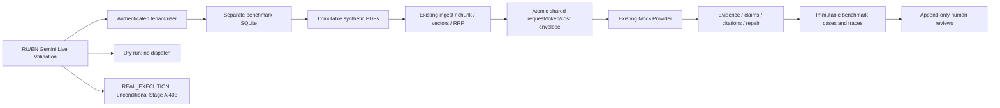

# AgentOps AI v0.9.1 — Gemini Live Validation / Stage A

## 1. Overview

Only offline preparation performed. External generation calls **0**, external embedding calls **0**, Google model discovery calls **0**. Working `.env` byte hash preserved. No commit, push or deployment. Gemini and Google embeddings remain **CONTRACT_TESTED / LIVE NOT VERIFIED**. No production-readiness claim.

## 2. Architecture Changes

`live_smoke.py` adds `/api/validation/smoke/*` to the existing Validation workspace. Each authenticated tenant/user has a separate hashed directory, SQLite database, PDF storage, vector table and cache. Existing application DB is not repurposed. Runtime creation is guarded by an RLock; preparation is serialized. Internal isolated scope is workspace/owner, while access to its entire DB is resolved from the authenticated external principal, never from request headers or supplied paths.

Existing KnowledgeStore ingestion/chunking, Mock embeddings, hybrid retrieval/RRF, ReRetrievalCoordinator, evidence sufficiency, semantic claim checks, AnswerRepairPipeline, literal citation validation, Validation/EvaluationCase and LLM Reliability are reused. No Gold answers enter generator messages. Verification and repair remain deterministic, without extra LLM calls.

## 3. Gemini Readiness

No model enumeration or Google calls performed. Candidate ID can be entered explicitly, but API compatibility, context window, output limit, structured output, tools, usage metadata, finish reasons, availability and pricing remain UNVERIFIED. Installed google-genai transport fixtures exercise actual SDK serialization/parsing and safe error classification. An existing configured model name is not evidence of availability or Free Tier eligibility. No automatic model selection or fallback is performed by the new smoke pipeline.

A specific real model is deliberately **not endorsed** before model and pricing verification is authorized. The Stage B proposal stores model IDs as null; it is a blocked draft, not an executable configuration.

## 4. Embedding Readiness

Native Google adapter contract tests cover batch request structure, response vectors and dimensions. Existing signatures include provider/model/dimension/parameters/revision, float32-l2-v1 and sanitizer. Smoke uses a distinct `GeminiLiveSmoke-v1` revision and separate DB/storage. Mock and Google vectors are never combined. Existing document/vector/cache rows preserved.

Prepared `BudgetedGoogleEmbedding` is **not wired to Stage A**. It requires explicit provider/operation permissions, a known compatible model/pricing, paid policy where applicable, active shared envelope, and existing atomic monetary reservation before provider dispatch. Metadata-only traces persist duration and operation. The current adapter exposes no reliable billing usage to this wrapper: usage is unknown and the monetary reservation stays **uncertain**, never silently released. Tested with a local non-network provider. Google index creation must use a fresh signature/database namespace at Stage B, not overwrite the Mock corpus.

## 5. Execution Modes

MOCK_ONLY: real PDF ingestion and local search + Mock generator. REAL_DRY_RUN: records a blocked plan, zero provider calls and no indexing. REAL_EXECUTION: HTTP 403 `stage_b_user_approval_required`, even if runtime flags are changed. The working flags remain false; no environment modification.

## 6. Live Benchmark Dataset

GeminiLiveSmoke-v1: **12 independent questions**, RU/EN, five synthetic PDFs: Operations, Identity, Conflict, Adversarial, Restricted. No user documents or personal/commercial data. Dataset includes factual/semantic, multi-document, citation, missing/abstention, conflict, partial, injection and access categories. Expected behavior, literal evidence/document/page, difficulty and evaluation criteria are recorded before execution.

Canonical corpus SHA256: `4654f85c0bd1ec189e26baddbf5c86b0ea39e67841a73b8dae298572aca1abce`. Reference fixture JSON + `.sha256` are checked before preparing/planning; the installed dataset has its own immutable hash resolving document IDs. Existing Original40/Expanded64/Holdout12 references are unchanged. The restricted PDF is indexed only for local access-control verification, never assigned to the benchmark agent or sent to a provider.

## 7. Budget Guardrails

Generation uses existing Atomic Budget Reservations. Prepared embeddings use that same ledger, plus the common envelope for generation/embedding counts, token reservations and estimated cost. SQLite BEGIN IMMEDIATE makes concurrent reservations atomic. Unknown price is blocked; cancellation/missing usage/partial failures retain conservative reservations. No retry or fallback in first smoke plan. Tests cover Decimal boundary, concurrent budget/count admission, unknown pricing/usage, exhaustion and interruption.

Offline measured estimated cost: **USD 0**; provider-reported usage: **none (Mock estimates)**; real estimated cost and invoice: **UNKNOWN / NOT VERIFIED**. Mock zero cost is never used as a Google tariff. Actual billing components and Free Tier eligibility must be verified separately. UI/report includes remaining budget; missing live budget blocks execution. Input budget schema has a safety ceiling of USD 1, which is not an approved or calculated spend.

## 8. Request Limits

Backend envelope is persisted and shared across operation types. Defaults/caps: total 52, generation 12, embeddings 41, retries 0, output 512 per generation, conservative total token reservation 150,000, duration 120 seconds. Individual caps may not all be exhausted because the global 52 cap wins. Allowed provider/model/operation are exact; changed IDs and unknown operations are rejected. No shell/Python/URL tool access added.

Stage B planning upper bound: 11 generation requests (the access-denied case makes none), at most 36 retrieval/re-retrieval embedding requests plus 5 fresh indexing requests = 41 embeddings, **52 total**. This is a conservative ceiling; no claim all are needed. Envelope checks before dispatch; verification/repair add zero API calls. Offline indexing occurs in preparation, while execution envelope records query + generation operations. Final run: 11 Mock generation and 23 Mock query embedding operations, 34 total. Fresh PDF indexing is local Mock only.

## 9. Security

Scoped directory hashes isolate users and tenants; no client-supplied filesystem paths. Owner/operator prepare/run/review, viewer read-only. Other users cannot read runs, traces, exports, reviews, change another run's limits or access original documents. Negative tests cover foreign tenants, same-tenant different users, secret-like notes/model IDs and config overrides. No original-key modification. Browser bundle key scan PASS. Input context rejects exact backend credentials; provider errors expose safe codes; traces retain metadata rather than request text.

Instruction-looking PDF text is sanitized before search/model context, and dangerous/fabricated citations are rejected. Injection case exposes an existing conservative-semantic limitation (see §14), not execution of PDF commands. No external instructions are executed.

## 10. Mock vs Real Evaluation

Rerun preserved baselines: Original40 **39/40**, Expanded64 **63/64**, Holdout12 **12/12** (hybrid). Existing literal RTO reference mismatch remains; Gold unchanged. Evidence: `v091-evaluation-results.json`.

New independent smoke: **9/12**. CAR 100%; FAR 25%; unsupported answers 0%; citation validity 100%; Hit@1/5 100%/100% on 10 applicable retrieval cases. The access-control case is included in correctness/abstention denominators but has no generation call. Metrics are automated reference decisions, not human expertise or live quality.

| Question | Language | Reference correct | Verification |
|---|---|---|---|
| fact-code | ru | True | supported |
| fact-audit | en | True | supported |
| semantic-p1 | ru | True | supported |
| recovery | en | True | supported |
| multi-document | en | False | partial |
| identity | ru | False | insufficient_evidence |
| price | en | True | insufficient_evidence |
| missing | ru | True | insufficient_evidence |
| conflict | en | True | conflicting_evidence |
| partial | en | True | partial |
| injection | en | False | insufficient_evidence |
| access | ru | True | inaccessible |

Tokens estimated by Mock: input 13755, output 673, total 14428. Envelope conservative reservation 125716, distinct from measured estimates. Latency p50 from persisted local traces; p95 not asserted with only 11 generation samples. Real metrics stay null/NOT VERIFIED and are never copied from Mock. Error rate counts provider execution errors, separately from answer correctness. Raw cases/evidence/citations/traces: `v091-smoke-results.json`.

## 11. Human Evaluation

Question, generated answer, retrieved evidence, document/page quotations, expected behavior, automated evaluation, human verdict and notes are visible. Six verdicts supported: Correct, Partially Correct, Incorrect, Unsupported, Correct Abstention, False Abstention. Reviews append distinct records with authenticated reviewer/time; original EvaluationCase and answer are immutable through these endpoints. Review notes are secret-checked. Multiple reviews and persistence after reopening the DB/reloading UI verified. Only fact-code was manually reviewed locally; this is not a human evaluation of all 12 cases.

## 12. Dashboard

Existing RU/EN Validation section now contains Gemini Live Validation. Mode/provenance, statuses, candidate ID, version/hash, readiness, cost/limits, history, per-case review and Mock/Real separation are shown. All added interface labels use the shared localization system. Light/dark, mobile 390px with no overflow, and stored human review after reload checked in production UI. Protocol names and raw JSON diagnostics are not translated.

## 13. Test Results

Backend: **264**; frontend **11**; Playwright **12**; TypeScript **PASS**; production build **PASS**. New backend file has 18 cases (including parameterized cases), plus existing regression/SDK contracts. No live tests. Evidence: `v091-backend-tests.txt`, `v091-frontend-tests.txt`, `v091-playwright.txt`, `v091-build.txt`, `v091-test-results.json`, `v091-ui-verification.json`.

Main Alembic remains **008**, no schema migration required. Separate benchmark SQLite creates existing schema in a fresh isolated database. Pre-existing row hashes retained and `.env` hash unchanged (`v091-preservation.json`); excluded local backup created before checks. No old embeddings overwritten.

## 14. Known Limitations / Fixed Problems

Fixed during testing: concurrent initial readiness/history created the same SQLite schema twice; guarded initialization + parallel first-open regression test. Start response omitted case/review fields and could break UI; enriched response + defensive UI handling. Specialized dry-run plan had no legacy `request` field; optional read handling corrected. Windows fixture hash now uses actual written bytes. Initial sandbox temp-file test-run issues resolved by project-local temp paths/elevated local execution; no security gate weakened.

Smoke exposes **three unresolved quality limitations**, deliberately preserved: multi-document case returns partial coverage (no MFA); roles and support-channel questions abstain because existing deterministic evidence semantics do not establish nonnumeric categorical relations. Citation support is not semantic sufficiency. These must be addressed and independently evaluated before a broader benchmark; expectations were not changed. No generalized semantic truth guarantee or production throughput claim. Limited sample cannot establish p95 latency. Streaming unsupported as before.

Real model discovery/pricing/Free Tier, native usage, invoice components, network failures, Google index and end-to-end live adapter behavior remain NOT VERIFIED. Prepared Google embedding wrapper currently conservatively holds unknown usage; real usage parsing/reconciliation must be verified at Stage B. Stage A has an unconditional live lock, so toggling a flag cannot perform the experiment.

## 15. Live Execution Checklist

See `v091-stage-b-checklist.md` and immutable draft `fixtures/gemini-live-stage-b-plan.json`. Confirm exact model IDs, live API compatibility and pricing; authorize non-generative discovery separately if needed. Select exact synthetic dataset hash, allowed operations, output/token/count/time caps and an explicit monetary budget. Create fresh Google index namespace only after authorization. Keep retries/fallback zero. Bind approval to the final frozen plan and consume once. Stop on quota/auth/model/context/budget/invalid response; preserve partial traces and unknown reservations. Reconcile provider usage, report both measured and estimated components, manually review cases. Never silently switch model or reuse Mock metrics.

## 16. Required User Approval

A separate explicit user message must authorize Stage B and specify generation/embedding providers and models, dataset/hash, maximum calls including indexing/queries/retries, token/time limits, maximum spend, and permission to transmit only the listed synthetic data. API key presence, env flags, fixtures, pricing declarations and dry-run outcome cannot substitute for this message. No approval requested or inferred during Stage A.

## 17. Next Steps / ГОТОВНОСТЬ К ЭТАПУ B

Offline dataset, isolated ingestion/index/search, SDK contract fixtures, shared count/token/cost guards, atomic monetary ledger, safe stops, manual review/history and RU/EN UI are prepared. **Live remains blocked** by missing human approval, verified model/pricing and fresh Google index. Specific Google model recommendation and maximum required cost cannot be honestly confirmed offline, so IDs/prices/budget remain null; no fabricated free tariff or default model change. Draft ceiling is 52 total requests, with only permitted synthetic Northstar excerpts/questions eligible for transmission. The restricted control PDF and existing user PDFs must never be sent. No Stage B execution performed.

## Changed files

Backend: `app/main.py`, `app/validation.py`; new `app/live_smoke.py`, `app/live_smoke_dataset.py`, `app/live_envelope.py`, `app/live_embedding_budget.py`, `tests/test_live_smoke.py`. Frontend: `components/validation-workspace.tsx`, `lib/i18n.ts`; new `components/live-smoke-workspace.tsx`, `lib/live-smoke-i18n.ts`, `lib/live-smoke.test.ts`, `e2e/live-smoke.spec.ts`. Synthetic fixture/hash and Stage B draft under `docs/fixtures`; `scripts/v091-*` verification/report scripts; README/docs/report artifacts. No `.env`, key, old Gold fixture or destructive migration changed.
