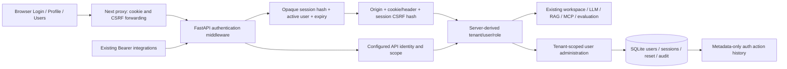

# AgentOps AI v1.0 — Authentication & User Management

## Overview

Local email/password authentication added to the existing application. No existing user/password model existed before this release. The 24 previous identities were programmatic configurations: one native workspace service identity and 23 isolated test identities. They were not silently converted into users in the main DB. External AI calls remain zero. No .env changes, production credential changes, commit, push or deployment.

## Architecture

The frontend no longer reads the owner token or injects it into every browser request. Unauthenticated requests get 401 and are redirected to Login. Explicit Bearer credentials remain valid for programmatic APIs. Browser identity is derived from the opaque session and current database record, not from headers or frontend role state.

## Login flow

GET `/api/auth/csrf` issues a pre-auth nonce cookie. POST `/api/auth/login` requires an approved Origin and matching nonce/header, validates normalized email and password, checks active status and atomic rate admission, then creates a server session. Success returns a public profile and cookies, never a password or session bearer value in JSON. Wrong password, unknown email and disabled account use the same `invalid_credentials` response. A salted dummy hash is verified for unknown emails.

`/login`, `/profile`, `/users`, `/access-denied`, `/session-expired` are supported. The workspace checks `/api/auth/me` before mounting. No long-lived authentication token is stored in localStorage; only existing locale/theme/preferences persist there. RU/EN, themes and responsive layout remain.

## Password storage

Standard-library OpenSSL scrypt: N=32768, r=8, p=1, 16-byte random salt, 64-byte derived key, maximum KDF memory allocation 64 MiB. Verification uses constant-time digest comparison and rejects unsupported hash parameter strings. This choice avoids introducing an unreviewed external dependency into the offline local build. Hashes have a versioned/parameterized encoding; all users have independent salts. Plaintext exists only in the explicitly requested, ignored development credential files and in transient password inputs.

Passwords must be 12–128 characters, have sufficient character diversity, avoid common dictionary-plus-digit passwords and the email local-part. A production rollout must benchmark/tune the work factor or review Argon2id migration against current security guidance; this is not a claim of production readiness.

Changing a password requires the current password and active browser session; the transaction rechecks active status/current hash and revokes every session of that user. Other users' passwords/sessions/data remain unaffected. No password is written to traces, API responses or audit payloads.

## Sessions, cookies and CSRF

Session identifiers and CSRF nonces are independent cryptographic random 32-byte values. SQLite stores SHA256 digests, not raw session/reset tokens. Sessions expire after a configured interval (default 8 hours), can be individually revoked, and logout marks the session revoked before clearing cookies. Account disable, role/status update, password change/reset and administrative session revocation invalidate target sessions.

Session cookie is HttpOnly, SameSite=Lax, path `/`. Secure is used automatically for HTTPS, approved HTTPS origins, explicit secure settings or non-local environments. HTTP development remains supported. Cookie-based mutations require exact Origin allowlist, matching CSRF cookie/header and the session's stored CSRF digest. Bearer APIs do not use cookie CSRF because credentials are explicitly supplied independently.

Main and auth-dev use different cookie names AND distinct Origin allowlists. Main trusts its 3000 UI/8000 local API; auth-dev trusts 3002/8002; Playwright trusts 3011. Cross-port requests cannot borrow a more privileged main browser session using a dev CSRF nonce. Proxy also rejects foreign Host/Origin and requires Origin on mutations.

## RBAC and tenant isolation

User roles: admin, operator, viewer. AI agent roles Planner/Researcher/Executor/Reviewer are unrelated and not user accounts. Admin manages only users matching their own tenant. Client-supplied tenant IDs and unsupported roles are rejected; own role/status management is denied; the last active administrator is protected. Viewer cannot mutate workspace resources or access user management.

Legacy agents/tasks/documents/workflows belong to the existing shared `workspace`, not newly invented per-user copies. Only active browser members of that tenant can read them; mutations require admin/operator. Other tenants get Access Denied for legacy resources and can use their scoped profile/user administration/LLM diagnostics as permitted. Existing narrower Bearer principal namespaces remain enforced. Validation's existing document/owner allowlist checks are preserved.

The legacy execution runners still use their workspace execution identity; this release does not claim per-user ownership of every old RAG/tool/Single/Multi record. A broader tenant-aware resource ownership migration requires separate design. Foreign-tenant access is blocked before these legacy handlers.

## User management and audit

Admin can list/create users, assign allowed roles, disable/enable, revoke sessions and issue one-use password resets. Ordinary users can view their profile, change password, list/revoke own sessions and logout. Public profile/session APIs exclude password hashes, raw session tokens and CSRF hashes.

Reset tokens are 32-byte random values, stored hashed, valid 15 minutes and consumed atomically once. They are delivered once to the authorized administrator for private manual delivery; there is no outbound email integration. Token is entered as POST body, never a URL. Completion rechecks active status and revokes target sessions. Reset does not touch other users.

Auth audit stores tenant, actor/target IDs, action and time for successful/failed login, logout, user creation/update, password changes/reset issuance/completion and revocation. Audit visibility is tenant-admin-only. No bodies, passwords, provider keys or reset token values are logged.

## Existing API compatibility and rotation plan

All 24 original API-only identities are retained separately from browser users. A new isolated auth-dev service credential and authentication-unit fixture credential are also documented. Browser disable/password change does not revoke independent API service credentials: that separation preserves existing integrations and must be managed explicitly.

Some historical fixture keys are short, known test constants. They must never be reused in production. Rotation plan: inventory owners/integrations; issue high-entropy scoped replacements with expiry and hashed registry storage; migrate clients during an overlap window; verify tenant/role policy; revoke old keys explicitly. No working key is automatically disabled or replaced in this release.

## SQLite migration and preservation

Alembic `009` follows `008`, adding users, user_sessions, login_attempts, auth_audit and password_resets. No old table/row is removed. A local SQLite backup was created under excluded backend/data/backups before migration. Existing row hashes and .env bytes are verified afterward. Downgrade is intentionally blocked pending explicit destructive-data review.

The main DB gets one new local browser administrator. The 23 browser counterparts of old fixtures live in a separate auth-dev SQLite/storage/checkpoint directory with namespaced tenants. Unit/Playwright users are created only in isolated test databases. Seed is local-only, refuses to reset existing unknown passwords, and is reproducible from a secret-free identity manifest plus existing fixture declarations. Credentials remain outside Git and Docker.

## Local accounts and launch

Actual email/password/ID/tenant/role/environment/verification are in **DEV_CREDENTIALS.local.md**, never README or this report. Inventory: 31 password entries = 1 main + 23 auth-dev + 4 unit snapshots + 3 Playwright snapshots. Native login/me/RBAC/logout verified for the 24 persistent local/dev entries; seven fixture entries verified through the actual ASGI authentication routes in isolated environments. UUIDs in temporary fixtures may be recreated on subsequent test runs. No OAuth integration exists.

Main UI: http://127.0.0.1:3000/login. Auth-dev UI: http://127.0.0.1:3002/login, backend 8002. Run local seed from root with `backend/.venv/Scripts/python.exe -X utf8 scripts/auth-development-seed.py`. Start main backend via normal script after Alembic; start isolated backend with `scripts/auth-development-server.py`. A second frontend uses BACKEND_URL=http://127.0.0.1:8002 on port 3002; no .env changes required.

## Regression timeout fix

Two original full-suite attempts hit legacy evaluation_timeout at 120 seconds; one retained 171/192 cases after successful calibration. A targeted test also exposed a fixed-count polling loop that could stop while evaluation was still running. Legacy Evaluation now uses the existing configured execution_timeout_seconds (default 180, bounded at 300); explicit Validation time/count/token caps remain unchanged and enforced. Polling now has a bounded deadline. A 1024-entry per-run offline read cache avoids duplicate search work; cache hits revalidate current scope/source versions and citations still query SQLite. No model output or Gold answer is cached, and no dataset/expected answer was changed. This is a local host performance observation, not a production throughput claim.

## Test results

Final measured counts and artifacts are populated in v10-test-results.json and the final report after all runs complete. Initial auth/migration subset: 14 passed. Targeted repaired v2 history/calibration regression: PASS. Frontend initial suite: 12 passed; TypeScript and build initially passed. Failed initial browser assertions/context setup were corrected without granting implicit owner access: locator scoped to the app alert, and the independent Playwright request context now carries the authenticated session and CSRF. Test traces are disabled and a secret-safe reporter redacts failure logs/artifacts.

Final Mock benchmarks passed: Original40 39/40, Expanded64 63/64, Holdout12 12/12. No Mock result is represented as live Gemini.

On the larger primary local database, calibration also exceeded its former 30-second subdeadline. The configurable calibration cap is now 60 seconds (validated range 1–60), bounded additionally by the run timeout. The final three benchmarks passed with this change; request/token caps remain enforced. The full backend suite preceded this final configuration change; the final benchmark exercised it afterward.

## Credential/build protection

DEV_CREDENTIALS.local.md is ignored by .gitignore/.dockerignore. The example file contains only structure. Private seed/password/API manifests reside under excluded backend/data. Frontend proxy no longer imports local owner secrets. Bundle/static checks scan actual local credentials without printing them. Git repository is absent; it is not initialized. Only the exact ignore pattern can be checked in a disposable verification repository; no current project index exists to verify/untrack.

There is no CI/CD pipeline or Docker build executed in this task. Exclusions and existing artifact paths are checked; test failure text is redacted before potential artifact publication. Production image/CI packaging require independent verification before deployment.

## Known limitations and production checklist

Not production-ready. Local HTTP lacks transport encryption; production requires HTTPS termination, explicit secure cookie/approved origin/Host settings, HSTS/frame/CSP headers, trusted proxy/IP rate-limiting design and distributed monitoring. Current DB-backed rate limits are atomic but aggregate proxy clients by backend-visible IP. There is no MFA, external email recovery or self-registration. Audit retention/pruning and enterprise alerting require operational policy.

Tune/review password KDF parameters and dependency supply chain, rotate short fixture API keys, validate backups/restore and session expiration, test distributed concurrency/rate limiting, review tenant/resource ownership of legacy workspace data, verify packaging excludes all development credentials, and perform an independent security review. No production/deployment change or external API operation is implied by this checklist.

## Changed files

Backend: config.py, db.py, main.py, new authentication.py/password_security.py, migration 009; evaluation.py for bounded run cache/configured deadline. Tests: new test_authentication.py, migration head and bounded v2 polling update. Frontend: protected page routes, application-workspace extraction, authentication component, shared api/CSRF helpers, proxy, auth RU/EN strings, styles and PDF upload CSRF forwarding. Playwright: authenticated fixture, auth scenarios, secret-safe reporter and existing specs using real login. Local seeds/verification/report scripts, secret-free auth identity manifest, credentials example, README and this report. Secret .env and existing API credentials unchanged.

## Final measured verification

- Backend full suite: **277 passed**. Auth suite: **16 passed** (includes 3 security cases added after the full suite was collected); **280 unique backend tests verified**, without double-counting the 13 overlapping auth cases.
- Frontend: **12 passed**; Playwright: **15 passed** in the full suite + **1 actual TTL-expiration scenario passed** (**16 unique scenarios**); TypeScript and production build: **PASS**. Native main/dev login, profile reload, logout, RU/EN/themes/mobile and independent cookie realms: PASS.
- Mock quality: **Original40 39/40, Expanded64 63/64, Holdout12 12/12**. Gold unchanged; no real AI requests.
- Password inventory: **31 verified entries**, 24 persistent local/dev and 7 isolated fixture snapshots. **24 original API identities retained**, 26 API credentials listed including new auth-dev/unit service identities.
- SQLite **009**, all pre-existing rows and .env bytes preserved, backup excluded. No commit/push/deployment.
- Build isolation: local production/E2E uses **frontend/.next-auth-production** through NEXT_DIST_DIR to avoid interference from shared dev .next processes. Docker/WSL services were not stopped. Configure the same variable for build/start; no .env edit required.
- Artifacts: v10-test-results.json, v10-backend-tests.txt, v10-auth-tests.txt, v10-frontend-tests.txt, v10-playwright.txt, v10-build.txt, v10-evaluation-results.json, v10-preservation.json, v10-security-checks.json, v10-ui-verification.json.
