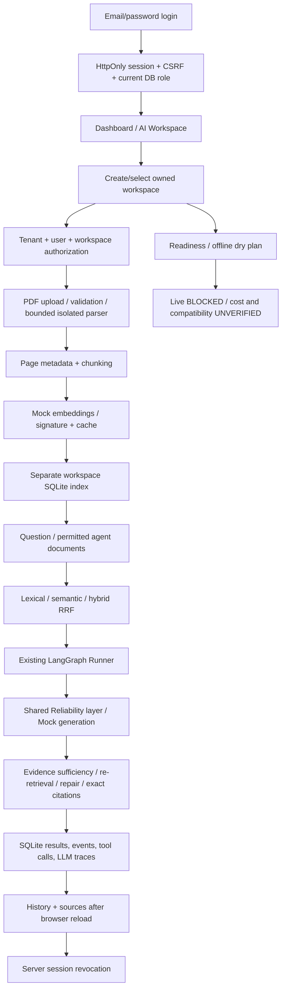

# AgentOps AI v1.1 — Offline E2E and Live Integration Readiness

## Architecture Overview

This release prepares Gemini/Google embeddings using the installed SDK and local HTTP transports. **External generation, embeddings and model discovery calls: 0. LIVE remains blocked; Gemini Live and Google Live UNVERIFIED.** No pricing/model capability is inferred from an existing API key. No production-ready claim.

Existing code inspected: Authentication, GeminiProvider/GoogleEmbeddingProvider, Reliability/Bound, KnowledgeStore/VectorIndex/hybrid_search, Runner/WorkflowRunner (LangGraph), evidence/repair/citations, Validation/Smoke/LiveEnvelope, profiling, Next proxy and RU/EN UI. v0.8/v0.9/v0.9.1/v1.0 reports provide historical context, not proof of live behavior.



## Full E2E Flow and Workspaces

`/ai` provides creation/selection, PDF upload, indexing progress, question submission, search mode, marked Mock answers, source/page/excerpt, request history, reload and cancellation. Existing dashboard, Single-Agent/Multi-Agent, MCP/HITL and shared legacy Knowledge Base remain available.

New catalog entries use existing LLMConfiguration (`ai_workspace`) in the primary database. Each entry stores immutable tenant/owner IDs; the client cannot set them. Its independent database/documents/checkpoints are under `ai-workspaces-v11/<hash(tenant,user,workspace)>`. No workspace deletion or access-sharing API is added. Maximum 10 workspaces per owner. Other tenants AND same-tenant other users get 404; wrong-workspace document IDs get 404. Legacy shared workspace permissions are unchanged.

The workspace gateway authorizes before opening the runtime, forwards only a fixed set of local ASGI routes, and supplies an internal ephemeral service token. It never forwards cookies or exposes that token. Child application reuses the existing handlers, LangGraph and data models; child apps cannot recursively create more workspace gateways. Child history uses legacy workspace/owner identity internally; external ownership is enforced by the enclosing catalog and physical database. Cross-workspace lookup never scans other database files.

## Gemini Integration

Installed google-genai native serialization/deserialization is tested with `httpx.MockTransport` (no sockets). Covered: structured JSON requests, maximum output, system policy, usage/cached/thinking tokens, finish reasons, tools with automatic function execution disabled, timeout/cancellation, 401/403/404/429/503, context limit, malformed JSON and transport interruption. SDK retries remain one attempt; Reliability performs its separately bounded policy.

New checks reject malformed model IDs before dispatch; blocked finish reasons and invalid/truncated structured output fail safely. Downstream role/RAG schemas still validate model-produced values; tool executor still validates every argument and permission. Model existence, Free Tier, native supported capabilities/context/output limits and actual latency/usage remain **UNVERIFIED**. No Google request or automatic paid fallback is made.

## Embeddings Integration

Google adapter validates task and bounded input batch, classifies authentication/model/rate/timeout failures, checks batch cardinality, finite nonzero vectors/dimension and L2 normalization. Signature includes provider/model/dimension/parameters/revision/float32 format/sanitizer; cache keys include task and text digest. Vector SQL filters permitted documents AND current signature. Existing dimension/mismatch/reindex tests are retained.

New offline workspaces force Mock embeddings with `AIWorkspace-v11-offline` revision. Each has a separate reserved `google-index-unverified` directory, containing **no Google vectors**. Future Google signature differs; no existing Mock index is overwritten. Native model compatibility/quality and external re-index execution are UNVERIFIED. A future live implementation must use fresh Google database/storage and the existing atomic LiveEnvelope/BudgetedGoogleEmbedding, not flip the active Mock index in place.

## Document Ingestion

PDF remains the supported format. Validation includes extension/magic, 5 MiB streamed bounds, bounded isolated parser process/time/output, encrypted/no-text/page/text error handling. Original extracted text is stored; only sanitized text is supplied as evidence. Page numbers/source hash/chunk IDs persist. Existing async extraction and vector indexing are actual operations, not UI fixtures.

The new UI combines extraction and embedding state: processing while either is running, indexed only when both are ready, failed on either error, reindex required for nonready embeddings. Upload response confirms acceptance before polling. Existing database status names remain compatible (`indexing`, `ready`, `failed`, `needs_consent`); no destructive state migration. Additional profiling records document_processing and indexing phases.

## RAG Pipeline and LangGraph Execution

Lexical/semantic/hybrid/RRF remain unchanged. Exact/paraphrased RU/EN, missing/partial/conflict/injection/access cases are covered by existing datasets and tests. Evidence sufficiency, bounded targeted re-retrieval, deterministic answer repair and literal citation checks remain enabled. Gold/reference answers are not added to generation context. Mock is explicit and its quality is not Gemini quality.

New workspace asks use the existing `/knowledge/ask` and Runner: knowledge_search tool event -> scoped context -> LangGraph model node -> Reliability -> verification -> execution/events/LLM trace commits. The new gateway requires Mock and blocks Gemini requests before generation. Cancellation and finite steps/tokens/time remain controlled by the existing runner. Existing workflow/tools/HITL/retry/atomic budget tests exercise those components; synthetic error fixtures are clearly distinguished from real provider failures.

## Authentication Integration and Security

Session/CSRF and explicit Bearer compatibility retained. Viewer cannot create/mutate workspaces; admin/operator can create their own. Provider/budget mutation in offline children is locked; no Google discovery or auth endpoints are forwarded. Disabled/revoked/expired accounts are rejected by parent authentication on every request. No .env change or user password reset is performed.

Trace access follows the workspace gateway and metadata-only LLM policy. Source lookup uses the selected child database; citation identity/page/source hash/span verification remains mandatory. Filesystem directories are computed from server IDs, never supplied paths. Existing allowlist/SSRF/tool approval protections remain in place. No shell/Python/unknown MCP API is added.

## Frontend

RU/EN, themes and mobile layout are retained. New screen explicitly marks OFFLINE E2E / Mock LLM / Mock embeddings / zero external calls, shows loading/errors/empty history, live readiness and source controls. `/ai` is linked from authenticated navigation. Provider errors are not substituted with a successful Mock answer. Production/E2E build directory `.next-v11` avoids overwriting running `.next-auth-production` servers; Next proxy accepts only local Host/Origin and forwards session+CSRF, including binary workspace PDF uploads.

## Testing and Performance

Final measured counts and performance will be recorded in `v11-test-results.json`; only completed executions may be claimed as PASS. Full backend/frontend/Playwright, TypeScript/build, migration tests and Original40/Expanded64/Holdout12 are executed locally. Primary preservation snapshot/backup precedes final tests; benchmarks run on a separate SQLite copy.

Profiling uses the existing content-free Profile/SQLite events with inclusive nested phases. Measurements are local samples, not production throughput; no p95/p99 claims from one E2E. UI responsiveness is tested through actual browser transitions and mobile overflow checks.

## Live Readiness and Controlled Live Test Plan

`GET /api/workspaces/{id}/readiness` performs no Google request and returns individual READY/BLOCKED/UNVERIFIED checks: user/tenant/workspace, key existence (boolean only), provider, generation/embedding model compatibility, indexed dataset, budget/count/token/retry, transmission consent, live authorization, logging/redaction, pricing and fresh Google index. Overall BLOCKED. `POST .../live` always rejects with 403 `live_user_approval_required`, regardless of key or environment flags. Existing `/validation/smoke` dry-run persists a blocked plan, not a live run.

Proposed future synthetic corpus: 3 short PDFs (operations/identity, continuity, conflicting/adversarial notes), each capped at 1 embedding batch. Six RU/EN questions: internal project code, audit retention, P1 reaction, RPO/RTO multi-document, unknown subscription price, injection/conflict refusal. No user documents. Restricted-source negative test is local and sends nothing.

The concrete blocked draft, synthetic contents and questions are in `docs/fixtures/v11-controlled-live-plan.json`; model IDs and pricing deliberately remain null/unverified. It is neither an authorization nor a generator answer bank.

Maximum dispatch ceiling: 3 indexing batches + 6 questions × at most 3 query/re-retrieval embeddings + 6 generations = **27 external calls**, retries 0, automatic fallback 0, extra verification/repair LLM calls 0 (deterministic local). Generation output cap 512 each (3072 total); shared conservative token envelope 150000, duration 120s. These are proposed ceilings, **not authorization**. Unknown tariffs/cost/free eligibility -> estimated cost UNKNOWN, dispatch BLOCKED. No rates are invented. Before authorization, obtain model/pricing/project eligibility evidence and an explicit bounded spend/data transmission decision; account for failed or cancelled possibly billed dispatches.

## Database Migration Status

No new schema migration required: Alembic remains **009**. New workspace catalogs reuse existing configuration storage; only brand-new isolated child databases are initialized. Users/sessions/documents/vector caches/evaluation traces/models/budgets in primary database are preserved. No deletion of existing data/index, commit/push/deployment or external AI calls.

## Known Limitations and v1.2 Recommendations

- Gemini/Google Live remains UNVERIFIED; `/live` has no executable live dispatcher in this release. Offline contracts do not establish real quality, quota or tariffs.
- Workspace access is owner-only, without team memberships/sharing; legacy workspace remains shared under v1.0 permissions. Internal child traces retain the legacy execution identity, with external scope enforced at the gateway.
- Independent workspace databases use current Base schema for initial creation. Future schema upgrades across existing child databases need explicit versioned migration coordination.
- Active workspace runtimes stay in process until shutdown. Multi-worker coordination, idle eviction and cross-process resource ceilings require further work.
- Google index reservation is an empty isolated namespace, not a verified embedding index. Sync embedding cancellation cannot undo a dispatched request.
- No MFA/external recovery/production packaging/security audit is added. Some semantic evidence verifier limitations and the existing one-case RTO reference mismatch remain; references are not changed to improve scores.
- v1.2: consent-bound live dispatcher, verified model/pricing registry, workspace team policy, scoped trace identity, versioned child migrations, runtime lifecycle limits and independent production security/load review.

## Changed Files

Backend: ai_workspaces.py, main.py, config.py, providers.py, embeddings.py, knowledge_store.py, vector_index.py. Tests: test_ai_workspaces_v11.py, extended test_gemini_transport_contract.py, bounded polling in test_api.py/test_rag.py/test_workflows.py. Frontend: /ai, ai-workspace.tsx, authentication.tsx, proxy, styles, Playwright config/new spec. Scripts: v11-preservation.py, v11-regression.py and final report/profiling helpers; README/docs/ignore rules. No .env edit.

## Integration Issues Found and Fixed

- Model-ID syntax validation initially excluded a one-character test fixture; compatibility is preserved without claiming the model exists.
- Under Windows test/browser load, extraction exceeded the historical 20-second cap. PDF processing now has a configurable 30-second default, bounded at 60. Fixed-count test waits of 3–6 seconds were shorter than allowed processing; they now use bounded monotonic deadlines. Product limits, Gold and expected assertions remain intact.
- A new ask retained the previously selected run while preparing its request, so a rapid cancel could target the older run. Selection clears at submission. Browser testing checks the new run ID, cancellation HTTP 200 and terminal cancelled status; backend regression confirms cancellation cannot be overwritten by completion.
- Browser tests initially matched both the application alert and Next route announcer, and checked protected access before async logout completed. Assertions now scope the application alert and await the confirmed Sign in screen before checking 401. No application error or access assertion is suppressed.
- Initial browser results are retained in v11-playwright-initial.txt; final PASS counts use only completed verification runs.

Local MCP startup initially shared the five-second RPC read timeout and could become unavailable under Windows process-start load. Initialize now has a separately bounded 20-second startup timeout (configurable 1–30); tool RPC timeout remains five seconds, no automatic reconnect/retry or endpoint expansion. Only the bundled read-only server is launched.

Additional changed files for that fix: `backend/app/mcp_client.py`, `backend/app/tool_execution.py`, and bounded embedding/MCP test polling in `backend/tests/test_embeddings_v05.py`. `backend/tests/test_gemini_langgraph_v11.py` separately proves native SDK request/response through the real LangGraph runner and shared budget/SQLite layer, using in-process HTTP fixtures only.

## Final Measured Verification

Backend **304 passed**, frontend **12 passed**, Playwright **17 passed**. TypeScript / production build PASS. Full OFFLINE E2E and SQLite reload/source persistence PASS. Gemini and embeddings CONTRACT PASS; Live UNVERIFIED. Mock benchmarks 39/40, 63/64, 12/12. Primary rows and .env unchanged; Alembic 009. External generation/embedding/discovery 0; commit/push/deployment none.

Additional native Gemini SDK -> local HTTP fixture -> LangGraph -> budget reconciliation -> SQLite contract: **1 passed**, added after the full suite collection. **305 unique backend tests verified**, without claiming they ran in one full invocation. This fixture is not a live Gemini response; its usage values and zero fixture rates are not Google usage/pricing.

After the final MCP startup-timeout adjustment, the tools/MCP/embedding regression subset also passed: **65 tests** (overlap the full suite; not added to the unique count). The final full Playwright run uses that configuration as well. Native runtime health and offline gates PASS.

Local inclusive E2E profile (single sample, not production throughput):

```json
{
  "total_ms": 2734.626,
  "phases_ms": {
    "sqlite_read": 142.549,
    "sqlite_write": 5.222,
    "sqlite_commit": 83.069,
    "trace_persistence": 13.487,
    "indexing": 44.108,
    "document_processing": 1339.08,
    "reranking": 11.98,
    "retrieval": 43.141,
    "embedding": 2.277,
    "reretrieval": 14.838,
    "generation": 2.29,
    "llm_total": 18.609,
    "repair": 6.735,
    "verification": 14.272
  },
  "counts": {
    "sqlite_reads": 368,
    "sqlite_writes": 50,
    "commits": 41
  }
}
```
